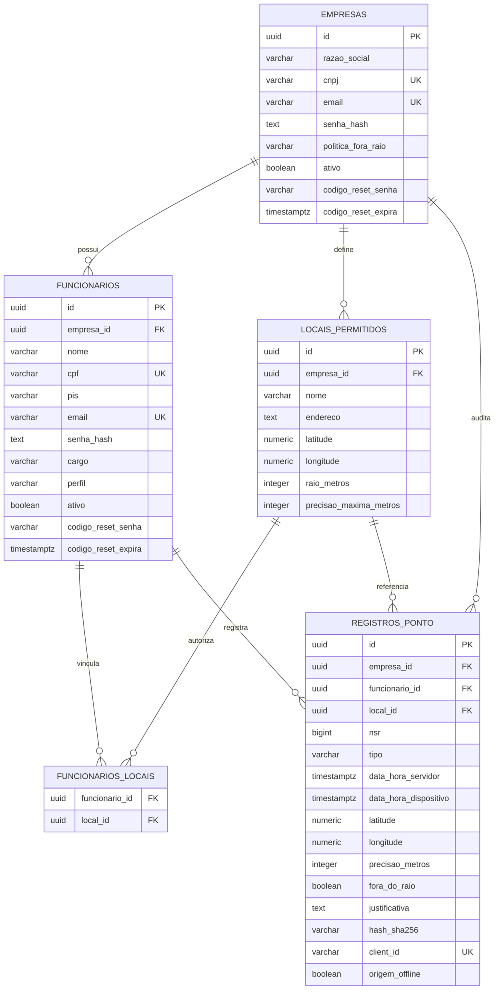

<div align="center">

# NexoTempo API (REP-P)

**Jornada registrada. Confiança comprovada.**

API RESTful de registro eletrônico de ponto desenvolvida em **Node.js**, **Express** e **PostgreSQL**, em conformidade com a **Portaria MTP nº 671/2021 (REP-P)**. Suporta autenticação unificada com RBAC, geofencing, sincronização offline idempotente, rastreabilidade criptográfica e geração de Espelho de Ponto em PDF.

<p>
  
  
  
  
</p>

</div>

---

## Visão Geral

O **NexoTempo API** centraliza as regras de negócio, segurança e auditoria do ecossistema NexoTempo. A arquitetura foi desenhada para operar em conjunto com o aplicativo mobile **Offline-First** (`nexotempo-app`), garantindo integridade jurídica dos registros mesmo diante de quedas de conexão ou retentativas simultâneas.

### Pilares Técnicos

- **Autenticação Unificada e RBAC (JWT):** um único ponto de entrada (`/auth/login`) valida credenciais de colaboradores (`COLABORADOR`), gestores (`ADMIN`, `RH`) e contas matriz (`EMPRESA`) com senhas criptografadas via `bcryptjs`.
- **Recuperação de Senha Segura:** fluxo em 2 etapas com código temporário de 6 dígitos gerado via `crypto.randomInt` e validade de 15 minutos no PostgreSQL.
- **Idempotência para Sincronização Offline:** controle via índice único parcial em `(empresa_id, client_id)` impedindo duplicidade de batidas quando a fila offline do app reenvia pacotes pendentes.
- **Conformidade Portaria 671 (REP-P):** geração de **NSR** sequencial, registro simultâneo de `data_hora_servidor` e `data_hora_dispositivo`, flag `origem_offline`, integridade via **SHA-256** e emissão oficial de **Espelho de Ponto em PDF** com `pdfkit`.

---

## Casos de Uso

### Diagrama de Casos de Uso


### Matriz de Atores e Funcionalidades

| Código | Caso de Uso | Ator Principal | Descrição |
|---|---|---|---|
| **UC01** | Realizar Login Unificado | Colaborador / Admin / Empresa | Autentica credenciais nas tabelas `funcionarios` e `empresas`, emitindo token JWT com perfil e `empresa_id`. |
| **UC02** | Recuperar e Redefinir Senha | Colaborador / Admin / Empresa | Gera código temporário de 6 dígitos com expiração de 15 minutos e atualiza `senha_hash`. |
| **UC03** | Registrar Ponto (Online / Offline) | Colaborador | Grava marcação com coordenadas GPS, precisão, validação de perímetro, NSR e `client_id` idempotente. |
| **UC04** | Registrar Justificativa Fora do Raio | Colaborador | Anexa justificativa auditável quando a marcação ocorre fora do raio dos locais autorizados. |
| **UC05** | Consultar Extrato Diário | Colaborador | Retorna as marcações do dia atual com status de geofencing, NSR e hash criptográfico. |
| **UC06** | Visualizar Dashboard Gerencial | Admin / RH / Empresa | Consolida KPIs de colaboradores ativos, registros de hoje, alertas fora do raio e locais cadastrados. |
| **UC07** | Gerenciar Colaboradores | Admin / RH / Empresa | Cadastra novos colaboradores (vinculando-os automaticamente aos locais da empresa) e ativa/desativa acessos. |
| **UC08** | Gerenciar Locais Permitidos | Admin / RH / Empresa | Cria zonas de geofencing com latitude, longitude e raio permitido em metros. |
| **UC09** | Emitir Espelho de Ponto em PDF | Admin / RH / Empresa | Gera PDF auditável (Portaria 671) filtrado por colaborador e intervalo de datas com campos de assinatura. |
| **UC10** | Gerenciar Ajustes de Ponto | Colaborador / Admin | Registra e acompanha solicitações de ajuste sem sobrescrever o histórico original imutável. |

---

## Modelagem de Dados

### Diagrama Entidade-Relacionamento (DER)


### Visão Lógica das Entidades (Mermaid)



### Regras de Integridade no PostgreSQL

| Regra | Mecanismo | Objetivo |
|---|---|---|
| **Isolamento Multi-Tenant** | `empresa_id` em todas as consultas | Impede vazamento de dados entre empresas distintas |
| **Idempotência Offline** | `UNIQUE INDEX (empresa_id, client_id) WHERE client_id IS NOT NULL` | Evita duplicação de registros reenviados pela fila offline |
| **Segurança de Credenciais** | `bcryptjs` / `pgcrypto` (custo 10) | Armazenamento irreversível de senhas |
| **Expiração de Reset** | `codigo_reset_expira > NOW()` | Invalida automaticamente códigos após 15 minutos |

---

## Documentação da API

### Autenticação (`/auth`)

| Método | Endpoint | Acesso | Descrição |
|---|---|---|---|
| `POST` | `/auth/login` | Público | Login unificado (Colaborador, Admin, RH e Empresa) |
| `POST` | `/auth/funcionario/login` | Público | Login exclusivo de colaboradores |
| `POST` | `/auth/empresa/login` | Público | Login exclusivo de conta matriz da empresa |
| `POST` | `/auth/esqueci-senha` | Público | Gera código de 6 dígitos com validade de 15 minutos |
| `POST` | `/auth/resetar-senha` | Público | Valida código e atualiza a senha criptografada |

### Ponto Eletrônico e Cadastros Base

| Método | Endpoint | Acesso | Descrição |
|---|---|---|---|
| `GET` | `/ponto/hoje` | JWT | Lista marcações do dia do colaborador autenticado |
| `POST` | `/ponto/registrar` | JWT | Registra ponto online ou sincroniza item da fila offline |
| `GET` | `/locais` | JWT | Lista locais de geofencing vinculados |
| `*` | `/empresas` | JWT | Operações de cadastro e configuração da empresa |
| `*` | `/funcionarios` | JWT | Operações de gestão de colaboradores |
| `*` | `/ajustes` | JWT | Solicitações e histórico de ajustes de ponto |

### Painel Administrativo (`/admin`)

Todas as rotas exigem token JWT com `tipo === 'EMPRESA'` ou `perfil` em `['ADMIN', 'RH']`.

| Método | Endpoint | Descrição |
|---|---|---|
| `GET` | `/admin/dashboard` | Retorna empresa, KPIs, equipe, locais e últimos 30 registros |
| `POST` | `/admin/funcionarios` | Cadastra colaborador e vincula automaticamente aos locais da empresa |
| `PATCH` | `/admin/funcionarios/:id/status` | Ativa ou desativa o acesso de um colaborador |
| `POST` | `/admin/locais` | Cria local permitido com coordenadas GPS e vincula à equipe |
| `GET` | `/admin/espelho-pdf` | Emite PDF do Espelho de Ponto (`?funcionario_id=&data_inicio=&data_fim=&token=`) |

---

## Estrutura do Projeto

```text
ponto-api/
├── docs/
│   └── diagrams/
│       ├── casos-de-uso.png
│       └── modelagem-dados.png
├── src/
│   ├── db.js
│   └── routes/
│       ├── adminRoutes.js
│       ├── ajusteRoutes.js
│       ├── authRoutes.js
│       ├── empresaRoutes.js
│       ├── funcionarioRoutes.js
│       ├── localRoutes.js
│       └── pontoRoutes.js
├── .env.example
├── .gitignore
├── package.json
├── README.md
└── server.js
```

---

## Executando Localmente

### Pré-requisitos
- **Node.js 18+**
- **PostgreSQL 14+** com extensão `pgcrypto` habilitada

### Passo a passo

1. Clone o repositório e instale as dependências:
```bash
git clone [https://github.com/Kauasx09-Henrique/nexotempo-api.git](https://github.com/Kauasx09-Henrique/nexotempo-api.git)
cd nexotempo-api
npm install
```

2. Crie o arquivo `.env` a partir do modelo `.env.example` e preencha suas credenciais do PostgreSQL e `JWT_SECRET`.

3. Inicie o servidor:
```bash
node server.js
```

A API ficará disponível em `http://localhost:3333` (e acessível na rede local via `0.0.0.0:3333` para o aplicativo Expo Go).

---

## Autor

Desenvolvido por **Kauã Henrique** — [GitHub](https://github.com/Kauasx09-Henrique)